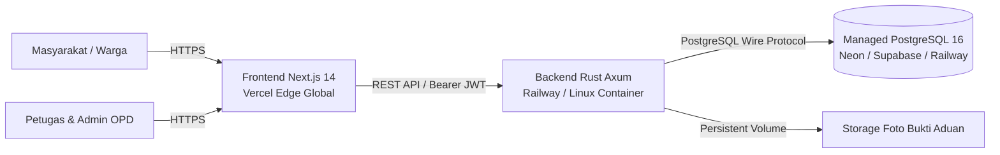

# PANDUAN DEPLOYMENT RESMI — LAMPUNG REPORT
## Smart Public Complaint Management System Kota Bandar Lampung

---

### 1. Arsitektur Infrastruktur Produksi

Aplikasi **LAMPUNG REPORT** didesain menggunakan arsitektur *decoupled full-stack*:



---

### 2. Opsi Deployment 1: Vercel (Frontend) + Railway (Backend) + Neon/Supabase (Database)

#### A. Persiapan Database PostgreSQL (Neon / Supabase / Railway)
1. Buat database PostgreSQL baru pada penyedia cloud (versi 15 atau 16 disarankan).
2. Catat URI koneksi produksi, pastikan menggunakan SSL:
   `postgres://<user>:<password>@<host>:5432/<dbname>?sslmode=require`
3. Jalankan skrip migrasi secara berurutan:
   - `backend/migrations/20261110000001_create_schema.sql` (13 Tabel, Triggers, Indexes)
   - `backend/migrations/20261110000002_seed_initial_data.sql` (4 Roles, 20 Kecamatan, 5 OPD, Demo Users)

#### B. Deployment Backend Rust Axum (Railway / Fly.io / Render)
1. Hubungkan repositori GitHub ke Railway / Render.
2. Atur **Root Directory** ke folder `/backend`.
3. Railway akan mendeteksi `Dockerfile` atau Cargo project secara otomatis.
4. Konfigurasikan variabel lingkungan (*Environment Variables*):
   | Variable | Value Rekomendasi | Keterangan |
   | :--- | :--- | :--- |
   | `SERVER_HOST` | `0.0.0.0` | Bind host container |
   | `SERVER_PORT` | `8080` (atau port dinamis platform) | Port HTTP server |
   | `APP_ENV` | `production` | Mode produksi |
   | `DATABASE_URL` | `postgres://...@...:5432/...` | URI PostgreSQL produksi |
   | `JWT_SECRET` | String acak 64 karakter (`openssl rand -base64 48`) | Kunci enkripsi token |
   | `ALLOWED_ORIGINS` | `https://lampung-report.vercel.app` | Whitelist domain frontend |
   | `UPLOAD_DIR` | `/app/uploads` | Lokasi berkas upload |
5. Endpoint Healthcheck: `GET /health` atau `GET /api/v1/health` (mengembalikan HTTP 200 `{ "status": "ok" }`).

#### C. Deployment Frontend Next.js 14 (Vercel)
1. Buka dashboard [Vercel](https://vercel.com) dan impor repositori GitHub.
2. Atur **Root Directory** ke folder `frontend`.
3. Vercel akan mendeteksi Next.js framework secara otomatis.
4. Konfigurasikan Environment Variables pada dashboard Vercel:
   | Variable | Value | Keterangan |
   | :--- | :--- | :--- |
   | `NEXT_PUBLIC_API_URL` | `https://api-lampung-report.railway.app/api/v1` | URL REST API Backend Rust |
   | `NODE_ENV` | `production` | Mode produksi Next.js |
5. Klik **Deploy**. Vercel akan melakukan optimasi CDN, edge routing, dan menerbitkan domain gratis `*.vercel.app` bersertifikat SSL/TLS otomatis.

---

### 3. Opsi Deployment 2: Single-Server Docker Compose (VPS / On-Premise)

Untuk deployment terpadu pada satu mesin server VPS (Ubuntu 22.04 / Debian 12 / AlmaLinux):

```bash
# 1. Clone repositori ke server
git clone https://github.com/username/lampung-report.git
cd lampung-report

# 2. Buat berkas environment produksi
cp backend/.env.production.example backend/.env
cp frontend/.env.production.example frontend/.env

# 3. Jalankan seluruh kontainer dengan Docker Compose
docker compose -f docker-compose.prod.yml up -d --build

# 4. Verifikasi status kontainer
docker compose -f docker-compose.prod.yml ps

# 5. Cek log operasional
docker compose -f docker-compose.prod.yml logs -f backend
```

---

### 4. Prosedur Backup & Disaster Recovery Database

Jadwalkan backup berkala harian (*cron job*) menggunakan `pg_dump`:

```bash
# Backup otomatis database
pg_dump -U lampung_admin -d lampung_report_prod -F c -b -v -f "/backup/lampung_report_$(date +%Y%m%d_%H%M%S).dump"

# Prosedur Restore jika terjadi kegagalan sistem
pg_restore -U lampung_admin -d lampung_report_prod -v -c "/backup/lampung_report_YYYYMMDD_HHMMSS.dump"
```

---

### 5. Checklist Kesiapan Produksi (Go-Live Checklist)

- [x] Database 13 entitas terinisialisasi dengan data wilayah 20 kecamatan Bandar Lampung.
- [x] Seluruh akun demo awal terlindungi dengan hash Argon2id (tanpa plaintext).
- [x] Token JWT menggunakan secret acak 64 karakter berdurasi 24 jam.
- [x] CORS dibatasi hanya ke domain resmi pemkot / aplikasi frontend.
- [x] HTTP Security Headers aktif (`nosniff`, `SAMEORIGIN`, `X-XSS`, `Referrer-Policy`).
- [x] Hak cipta wajib mahasiswa dan dosen pengampu persisten di footer.
- [x] Seluruh health check `/health` merespons HTTP 200 OK.

---

*Hak Cipta © 2026 by Ridho Fatahilah Joeda and Dr. Erliyan Redy Susanto, M.Kom. Seluruh hak cipta dilindungi undang-undang.*

