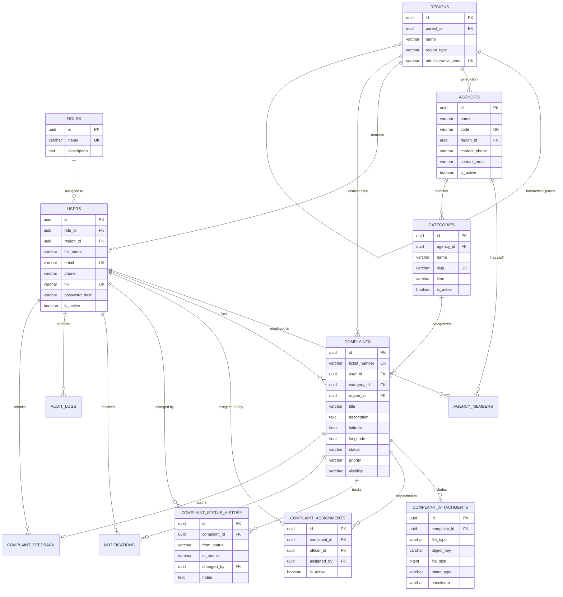

# DOKUMENTASI DATABASE (POSTGRESQL)
**LAMPUNG REPORT — Smart Public Complaint Management System**
*Proyek Pengembangan Sistem Informasi (UTS) | Universitas Teknokrat Indonesia*

---

## 1. Diagram Relasi Entitas (Entity-Relationship Diagram)



---

## 2. Kamus Data & Spesifikasi Tabel

### 2.1 `roles`
Menyimpan peran baku sistem.
- `id` (UUID, PK): Pengenal unik peran.
- `name` (VARCHAR(50), UNIQUE): Nama peran (`SUPER_ADMIN`, `AGENCY_ADMIN`, `OFFICER`, `CITIZEN`).
- `description` (TEXT): Deskripsi kewenangan peran.

### 2.2 `regions`
Menyimpan struktur wilayah bertingkat (Kota Bandar Lampung dan 20 Kecamatan).
- `id` (UUID, PK): Pengenal unik wilayah.
- `parent_id` (UUID, FK $\rightarrow$ `regions.id`, Nullable): Wilayah induk.
- `name` (VARCHAR(100)): Nama wilayah (misal: "Kedaton", "Way Halim").
- `region_type` (VARCHAR(30)): Tingkat wilayah (`KOTA`, `KECAMATAN`, `KELURAHAN`).
- `administrative_code` (VARCHAR(30), UNIQUE): Kode Kemendagri/BPS (misal: `187104`).

### 2.3 `agencies`
Menyimpan data Organisasi Perangkat Daerah (OPD) penanggung jawab aduan.
- `id` (UUID, PK): Pengenal instansi.
- `name` (VARCHAR(150)): Nama lengkap dinas (misal: "Dinas Perhubungan Kota Bandar Lampung").
- `code` (VARCHAR(50), UNIQUE): Singkatan resmi (`DISHUB`, `PU`, `DLH`, `POLPP`, `BPBD`).
- `is_active` (BOOLEAN): Status keaktifan instansi.

### 2.4 `users`
Menyimpan akun pengguna dari seluruh role.
- `id` (UUID, PK): Pengenal unik pengguna.
- `role_id` (UUID, FK $\rightarrow$ `roles.id`): Peran pengguna.
- `region_id` (UUID, FK $\rightarrow$ `regions.id`, Nullable): Wilayah domisili.
- `full_name` (VARCHAR(150)): Nama lengkap pengguna.
- `email` (VARCHAR(150), UNIQUE): Alamat surel aktif login.
- `phone` (VARCHAR(30)): Nomor telepon / WhatsApp.
- `nik` (VARCHAR(20), UNIQUE, Nullable): NIK 16 digit warga pelapor.
- `password_hash` (VARCHAR(255)): Hash password menggunakan Argon2id.
- `is_active` (BOOLEAN): Status keaktifan akun.

### 2.5 `agency_members`
Menghubungkan akun `AGENCY_ADMIN` dan `OFFICER` ke instansi/OPD masing-masing.
- `id` (UUID, PK): Pengenal keanggotaan.
- `agency_id` (UUID, FK $\rightarrow$ `agencies.id`): Instansi tempat bernaung.
- `user_id` (UUID, FK $\rightarrow$ `users.id`): Pengguna terkait.
- `membership_role` (VARCHAR(50)): Peran internal instansi (`ADMIN`, `OFFICER`, `COORDINATOR`).

### 2.6 `categories`
Taksonomi klasifikasi masalah pengaduan yang dipetakan ke OPD penanggung jawab.
- `id` (UUID, PK): Pengenal kategori.
- `agency_id` (UUID, FK $\rightarrow$ `agencies.id`): Dinas penindak.
- `name` (VARCHAR(100)): Nama kategori (misal: "Lampu Jalan & Traffic Light").
- `slug` (VARCHAR(100), UNIQUE): Identifier ramah URL.
- `icon` (VARCHAR(50)): Nama icon Material Symbols Outlined.

### 2.7 `complaints`
Tabel transaksi utama pengaduan masyarakat.
- `id` (UUID, PK): Identifier internal unik.
- `ticket_number` (VARCHAR(50), UNIQUE): Nomor tiket formal publik (`TKT-YYYYMMDD-XXXXX`).
- `user_id` (UUID, FK $\rightarrow$ `users.id`): Pelapor aduan.
- `category_id` (UUID, FK $\rightarrow$ `categories.id`): Kategori aduan.
- `region_id` (UUID, FK $\rightarrow$ `regions.id`, Nullable): Wilayah kecamatan terjadinya insiden.
- `title` (VARCHAR(255)): Judul ringkas aduan.
- `description` (TEXT): Kronologi lengkap insiden.
- `address_detail` (TEXT): Patokan fisik lokasi.
- `latitude` (DOUBLE PRECISION): Koordinat garis lintang (Check: $-90 \le \text{lat} \le 90$).
- `longitude` (DOUBLE PRECISION): Koordinat garis bujur (Check: $-180 \le \text{lon} \le 180$).
- `status` (VARCHAR(50)): Status siklus (`SUBMITTED`, `UNDER_REVIEW`, `VERIFIED`, `ASSIGNED`, `IN_PROGRESS`, `RESOLVED`, `REJECTED`, `CLOSED`).
- `priority` (VARCHAR(30)): Urgensi (`LOW`, `MEDIUM`, `HIGH`, `URGENT`).
- `visibility` (VARCHAR(30)): Hak publikasi (`PUBLIC`, `PRIVATE`).

### 2.8 `complaint_attachments`
Menyimpan metadata foto bukti pengaduan dan foto bukti penyelesaian.
- `id` (UUID, PK): Pengenal lampiran.
- `complaint_id` (UUID, FK $\rightarrow$ `complaints.id`): Pengaduan terkait.
- `file_type` (VARCHAR(30)): Jenis bukti (`EVIDENCE`, `FOLLOW_UP`, `COMPLETION`).
- `object_key` (VARCHAR(255)): Path/kunci penyimpanan berkas di disk/object storage.
- `file_size` (BIGINT): Ukuran berkas dalam byte (Check: $\le 5$ MB).
- `mime_type` (VARCHAR(100)): Tipe MIME (image/jpeg, image/png, image/webp).
- `checksum` (VARCHAR(64)): Hash SHA-256 untuk verifikasi integritas berkas.

### 2.9 `complaint_assignments`
Mencatat riwayat disposisi petugas lapangan.
- `id` (UUID, PK): Pengenal penugasan.
- `complaint_id` (UUID, FK $\rightarrow$ `complaints.id`): Pengaduan terkait.
- `officer_id` (UUID, FK $\rightarrow$ `users.id`): Petugas lapangan pelaksana.
- `assigned_by` (UUID, FK $\rightarrow$ `users.id`): Admin OPD yang menugaskan.
- `is_active` (BOOLEAN): Status keaktifan tugas.

### 2.10 `complaint_status_history`
Append-only log riwayat transisi status.
- `id` (UUID, PK): Pengenal histori.
- `complaint_id` (UUID, FK $\rightarrow$ `complaints.id`): Pengaduan terkait.
- `from_status` (VARCHAR(50), Nullable): Status sebelumnya.
- `to_status` (VARCHAR(50)): Status baru.
- `changed_by` (UUID, FK $\rightarrow$ `users.id`, Nullable): Aktor pengubah status.
- `notes` (TEXT): Catatan kronologi/alasan perubahan status.

### 2.11 `notifications`
Pusat pemberitahuan in-app bagi pelapor dan petugas.
- `id` (UUID, PK): Pengenal notifikasi.
- `user_id` (UUID, FK $\rightarrow$ `users.id`): Penerima notifikasi.
- `complaint_id` (UUID, FK $\rightarrow$ `complaints.id`, Nullable): Tiket terkait.
- `title` (VARCHAR(150)): Judul notifikasi.
- `message` (TEXT): Pesan detail.
- `is_read` (BOOLEAN): Status keterbacaan pesan.

### 2.12 `audit_logs`
Audit log administratif dan keamanan sistem.
- `id` (UUID, PK): Pengenal log.
- `actor_id` (UUID, FK $\rightarrow$ `users.id`, Nullable): Aktor pelaku aksi.
- `action` (VARCHAR(100)): Kode aksi (misal: `VERIFY_COMPLAINT`, `REJECT_COMPLAINT`, `ASSIGN_OFFICER`).
- `entity_type` (VARCHAR(100)): Entitas sasaran (`COMPLAINT`, `USER`, `AGENCY`).
- `entity_id` (VARCHAR(100)): ID sasaran.
- `metadata` (JSONB): Konteks perubahan (tanpa password/kredensial).

### 2.13 `complaint_feedback`
Umpan balik masyarakat setelah laporan dinyatakan `RESOLVED` / `CLOSED`.
- `id` (UUID, PK): Pengenal feedback.
- `complaint_id` (UUID, UNIQUE, FK $\rightarrow$ `complaints.id`): Satu penilaian per tiket.
- `user_id` (UUID, FK $\rightarrow$ `users.id`): Warga pemberi nilai.
- `rating` (INTEGER): Skala kepuasan 1 sampai 5.
- `feedback` (TEXT): Ulasan tertulis warga.

---

## 3. Panduan Eksekusi Migrasi Database

### Opsi A: Menggunakan `sqlx-cli` (Direkomendasikan)
```bash
# Pastikan database PostgreSQL telah dibuat
createdb -U postgres lampung_report

# Jalankan migrasi dari direktori backend
cd backend
sqlx migrate run
```

### Opsi B: Menggunakan Docker Compose (Lingkungan Terisolasi)
```bash
# Jalankan container PostgreSQL dari root workspace
docker compose up -d db

# Eksekusi file SQL migrasi secara berurutan
docker exec -i lampung-report-postgres psql -U postgres -d lampung_report < backend/migrations/20261110000001_create_schema.sql
docker exec -i lampung-report-postgres psql -U postgres -d lampung_report < backend/migrations/20261110000002_seed_initial_data.sql
```

### Opsi C: Menggunakan PostgreSQL CLI (`psql`)
```bash
psql -U postgres -d lampung_report -f backend/migrations/20261110000001_create_schema.sql
psql -U postgres -d lampung_report -f backend/migrations/20261110000002_seed_initial_data.sql
```

